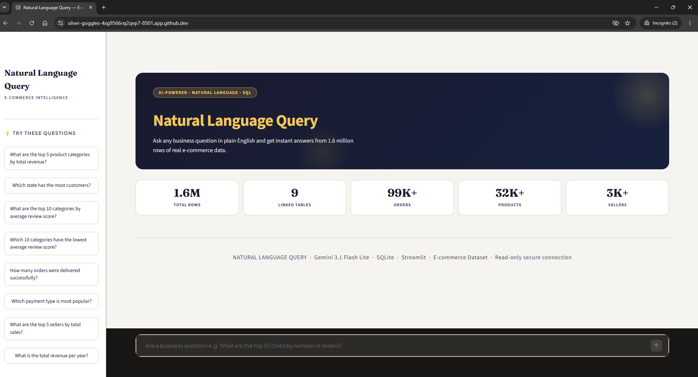
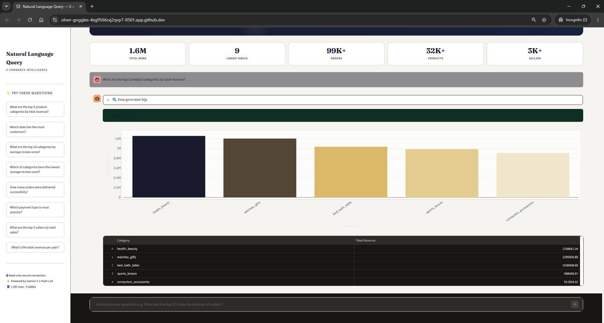
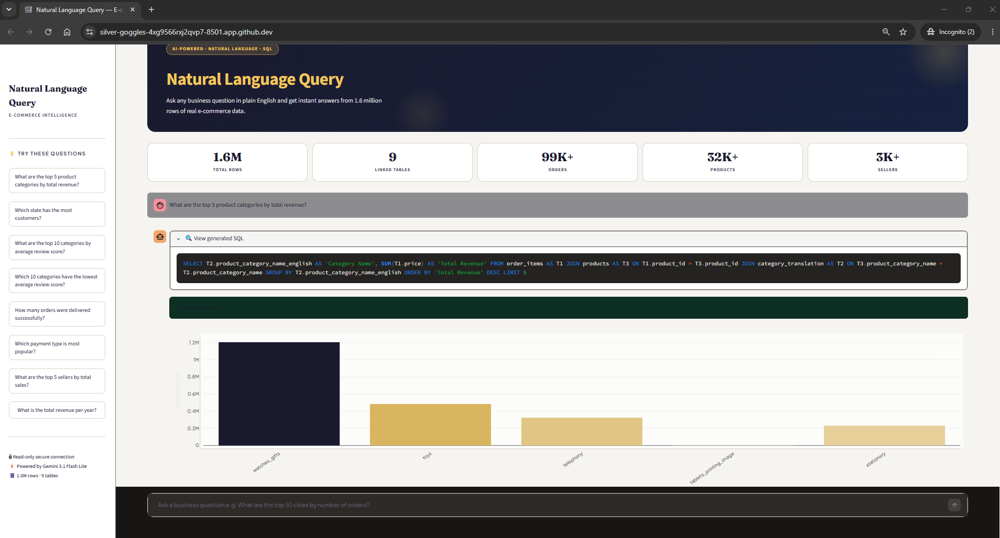
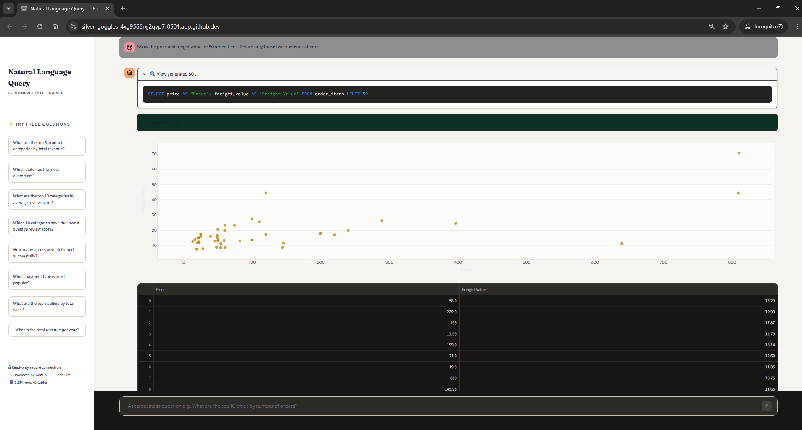
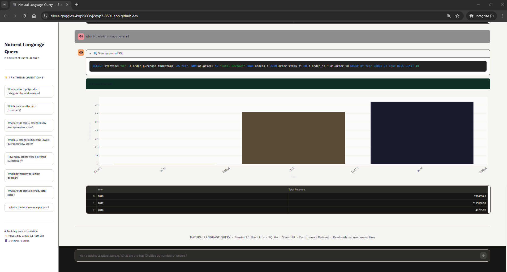
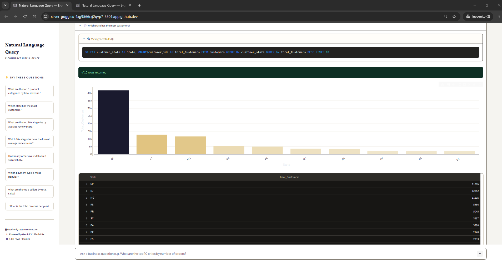
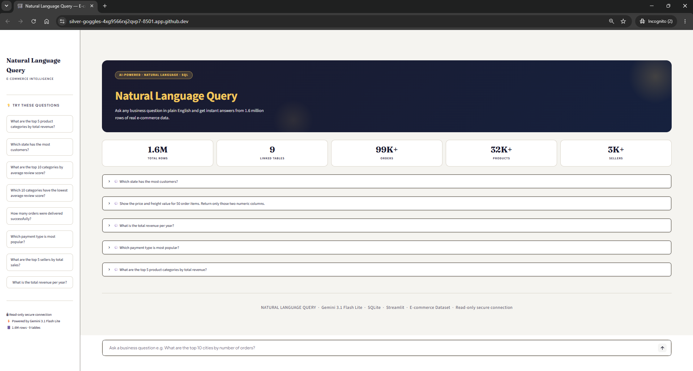

# Natural Language Query

**Ask business questions in plain English. Get SQL, tables, and charts back.**

Natural Language Query is an AI-powered analytics assistant. It turns plain-English questions into SQL, runs them against a real e-commerce database, and shows the results with the generated query visible for full transparency.



---

## ✨ Features

- **Plain-English to SQL** powered by Google Gemini (`gemini-3.1-flash-lite`), with automatic retries and fallback models when Google is busy
- **Collapsible question history.** Each question is a row. Click it to show or hide the answer, and the newest question opens first.
- **Transparent results.** Every answer includes the SQL that produced it, in an expandable block that wraps long queries.
- **Automatic charts** for categorical and numeric results, with a data table underneath
- **One-click starter questions** in the sidebar to explore the data quickly
- **Read-only database access.** Generated queries can read data but never change it.
- **Zero-setup database.** The SQLite database builds itself from the CSV files on first run.

---

## 🧰 Tech Stack

| Layer | Tools |
|---|---|
| Interface | Streamlit |
| AI model | Google Gemini API (`gemini-3.1-flash-lite`) |
| Database | SQLite |
| Data processing | pandas, SQLAlchemy |
| Visualization | Plotly |
| Config | python-dotenv |

---

## 📊 The Data

The app uses the **Brazilian E-Commerce Public Dataset by Olist**, available free on [Kaggle](https://www.kaggle.com/datasets/olistbr/brazilian-ecommerce).

It contains roughly **1.6 million rows** across **9 linked tables**, covering:

- Customers and sellers
- Orders, order items, and payments
- Product categories and reviews
- Geolocation data

---

## 🏗️ Project Structure

```
.
├── app.py                      # Streamlit app: UI, chat history, charts
├── python_runs/
│   ├── database_setup.py       # Builds ecommerce.db from the CSV files
│   ├── nl_to_sql.py            # Converts questions to SQL and runs them
│   └── test_gemini.py          # Checks the Gemini connection
├── ecommerce-data/             # Raw CSV files (not committed)
├── screenshots/                # Images used in this README
├── requirements.txt
└── .gitignore
```

---

## 🚀 Getting Started

This project is designed to run in **GitHub Codespaces**, so you don't need anything installed locally.

### 1. Get a free Gemini API key

1. Go to [Google AI Studio](https://aistudio.google.com/apikey).
2. Click **Create API key** and copy it.

### 2. Open a Codespace

Click **Code → Codespaces → Create codespace on main**.

### 3. Add your API key

In the terminal, create a `.env` file in the project root:

```bash
echo "GEMINI_API_KEY=your_key_here" > .env
```

`.env` is gitignored, so your key will never be committed.

### 4. Add the data

Create a folder named `ecommerce-data` and place these nine CSV files inside:

- `customers_dataset.csv`
- `orders_dataset.csv`
- `order_items_dataset.csv`
- `order_payments_dataset.csv`
- `order_reviews_dataset.csv`
- `products_dataset.csv`
- `sellers_dataset.csv`
- `geolocation_dataset.csv`
- `product_category_name_translation.csv`

### 5. Install dependencies

```bash
pip install -r requirements.txt
```

### 6. Test the connection

```bash
python python_runs/test_gemini.py
```

You should see `gemini says: The connection is alive and ready to build`.

### 7. Build the database

```bash
python python_runs/database_setup.py
```

This creates `ecommerce.db` in the project root. It takes a minute or two.

### 8. Run the app

```bash
streamlit run app.py
```

Click **Open in Browser** when the notification appears, or use the **Ports** tab to open port 8501.

---

## 💬 Example Questions

- *What are the top 5 product categories by total revenue?*
- *Which state has the most customers?*
- *Which 10 categories have the lowest average review score?*
- *What is the total revenue per year?*
- *Which payment type is most popular?*

---

## 🖼️ Screenshots

| | |
|---|---|
|  |  |
| **Query results with a bar chart** | **Generated SQL, shown for transparency** |
|  |  |
| **Scatter plot result** | **Payment type popularity** |
|  |  |
| **Which state has the most customers** | **Full question history, collapsible rows** |

---

## 🔒 Security Notes

- The database connection is opened in **read-only mode**, so generated SQL cannot modify data.
- API keys are stored in `.env` and excluded from version control.
- The app is for analysis and demonstration. Don't connect it to production data without adding access controls.

---

## 🛠️ Troubleshooting

| Problem | Fix |
|---|---|
| `GEMINI_API_KEY` not found | Check that `.env` is in the project root and has no quotes or spaces. |
| `ModuleNotFoundError` | Run `pip install -r requirements.txt` from the project root. |
| `FileNotFoundError` on a CSV | Check the filenames in `ecommerce-data/` against the list above. |
| 404 "model no longer available" | Google retired that model name. Update `MODEL` and `FALLBACK_MODELS` in `app.py` to a current model. |
| 429 / rate limit errors | Wait a minute. Free-tier limits are strict. |
| 503 "high demand" errors | Google's servers are busy. The app retries automatically; if it still fails, wait 30 seconds and ask again. |
| Port 8501 won't open | Check the **Ports** tab and confirm the app is still running. |

---

## 🙌 Acknowledgements

- [Olist](https://olist.com/) for the public e-commerce dataset
- [Google Gemini](https://ai.google.dev/) for the language model
- [Streamlit](https://streamlit.io/) for the app framework

---

## 📄 License

This project is licensed under the [MIT License](LICENSE).

---

*Built by [@hassanhassan5198](https://github.com/hassanhassan5198)*
